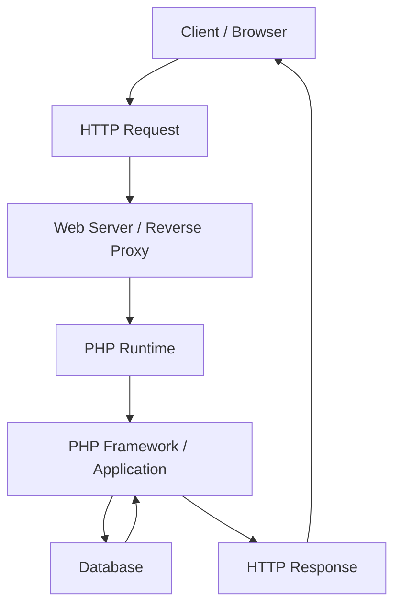
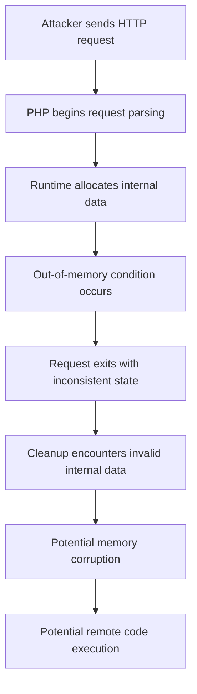
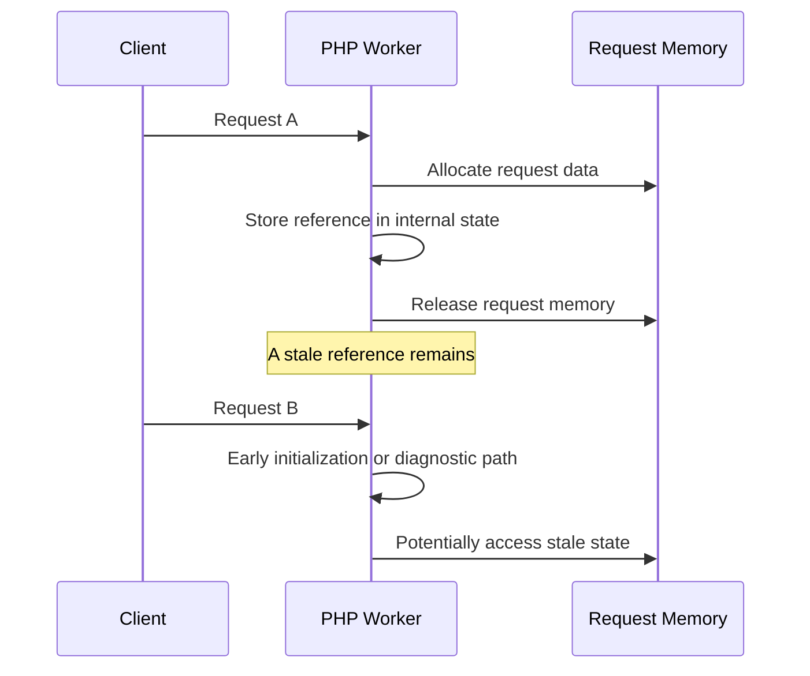
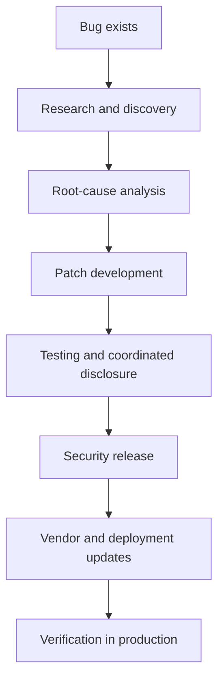

---

title: "PHP2Shell: Inside the PHP Security Crisis of October 2026"

description: "An updated technical investigation into PHP2Shell, the October 2026 PHP security advisories, confirmed exploitation reporting, Windows Brotli package updates, and defensive remediation."

category: "Security & Systems"

publishedDate: "2026-10-23"
lastUpdated: "2026-10-30"

tags:

  - PHP

  - Cybersecurity

  - Memory Safety

  - Remote Code Execution

  - Backend Engineering

  - Open Source Security

---

# PHP2Shell: Inside the PHP Security Crisis of October 2026

**How two vulnerabilities in PHP's runtime turned ordinary HTTP requests into a potential remote code execution risk**

On October 21, 2026, the PHP security team released emergency updates for two critical vulnerabilities in the PHP runtime. Tracked as **CVE-2026-109618** and **CVE-2026-109619**, the vulnerabilities were rated **CVSS 9.2** and could allow unauthenticated remote attackers to execute arbitrary code on affected systems.

The incident became known as **PHP2Shell**.

What made this incident particularly concerning was the location of the vulnerabilities. These were not merely bugs in a WordPress plugin, a Laravel controller, or a custom PHP application. They affected PHP's internal request-processing and memory-management behavior.

Under specific conditions, an attacker could trigger vulnerable behavior while PHP was processing an HTTP request, potentially before the application's own code executed.

On October 23, PHP published an additional informational advisory concerning a related, unusual session upload-progress configuration. This is a useful reminder that security incidents can continue evolving after the first patches are released.

Official references:

- [PHP security release announcement](https://www.php.net/archive/2026.php)

- [CVE-2026-109618: Out-of-memory corruption](https://github.com/php/php-src/security/advisories/GHSA-w8hw-w9fx-j79w)

- [CVE-2026-109619: Stale global state](https://github.com/php/php-src/security/advisories/GHSA-6wmf-4rv5-p3rp)

This article examines what happened, how the underlying bugs work, what a realistic attack scenario looks like, and what backend engineers can learn from the incident.

## Status update — October 30, 2026

This article was originally published on October 23, 2026. It has been updated to include developments reported through October 30.

| Date | Development | Why it matters |
|---|---|---|
| October 21 | PHP published fixes for CVE-2026-109618 and CVE-2026-109619. | The original PHP2Shell vulnerabilities received fixed upstream releases. |
| October 23 | PHP published an informational advisory for CVE-2026-115560. | A separate, uncommon session-configuration issue remains relevant; the October 21 releases do not fix it. |
| October 26 | CISA added CVE-2026-109618 and CVE-2026-109619 to its Known Exploited Vulnerabilities (KEV) catalog. | The vulnerabilities should be treated as actively exploited, not merely theoretical. |
| October 26–27 | PHP published rebuilt Windows packages containing Brotli 1.2.1 to address CVE-2026-111497. | Windows PHP users need the rebuilt `-1` packages; this is separate from PHP2Shell. |
| October 28–29 | Security reporting described successful exploitation in controlled honeypot environments and additional exploitation activity. | Confirmed exploitation evidence exists, but it should not be misrepresented as proof of widespread compromise of production websites. |

**Important distinction:** CVE-2026-109618 and CVE-2026-109619 are the two vulnerabilities collectively called PHP2Shell. CVE-2026-115560 and CVE-2026-111497 are separate issues and should not be presented as part of that original pair.

### What is confirmed about exploitation?

CISA's KEV listing records that the two PHP2Shell vulnerabilities have been exploited in the wild. Security researchers have also described successful command execution in controlled honeypot environments. That is meaningful evidence of exploitation, but it does not establish how many production organizations have been compromised.

When reporting incident impact, distinguish between:
- Scanning or attempted exploitation.
- A successful exploit in a controlled honeypot.
- Confirmed compromise of a named production organization.
- Widespread compromise across the internet.

These are different levels of evidence.

Sources:
- [Canadian Centre for Cyber Security — PHP2Shell advisory and updates](https://www.cyber.gc.ca/en/alerts-advisories/al26-026-critical-vulnerabilities-impacting-php-cve-2026-109618-cve-2026-109619)
- [RH-ISAC — CISA confirms PHP2Shell exploitation and KEV listing](https://rhisac.org/general-blog/update-cisa-confirms-php2shell-exploitation-added-to-kev/)
- [PHP2Shell Live — dated technical dossier and source tracker](https://php2shell.live/)

---

## 1. First, Understand Where PHP Fits in a Web Application

Before examining the vulnerabilities, we need to understand how a PHP application processes a request.

Consider a typical online shopping application.

A customer opens the website, adds products to a cart, and submits an order. The request travels through several layers before the application returns a response.

A simplified architecture looks like this:



Each component has a different responsibility.

**Web server or reverse proxy**

Receives HTTP traffic, handles connections, and may enforce request-size limits or other traffic policies.

**PHP runtime**

Initializes the request, parses request data, manages memory, executes PHP code, and performs request cleanup.

**Application or framework**

Runs business logic such as authentication, payment processing, validation, and database operations.

**Database**

Stores application data such as users, products, orders, and transactions.

The crucial detail is that the PHP runtime must perform internal work before application code can execute.

For example, when an incoming request contains `multipart/form-data`, PHP may need to parse its body and construct internal data structures before the application accesses `$_POST` or `$_FILES`.

If a vulnerability exists in that earlier processing stage, adding validation to a Laravel controller or a WordPress plugin cannot reliably protect the vulnerable operation.

This is the architectural reason PHP2Shell matters.

---

## 2. What Exactly Was PHP2Shell?

PHP2Shell refers to two related critical vulnerabilities in PHP's core runtime.

| Vulnerability | Root cause | Potential impact |
|---|---|---|
| CVE-2026-109618 | Improper handling of out-of-memory conditions during request processing | Memory corruption and remote code execution |
| CVE-2026-109619 | Request-owned state remaining accessible after its memory has been released | Use-after-free and remote code execution |

Both vulnerabilities concern internal state that PHP must manage correctly while processing and cleaning up requests.

They are particularly important because the affected operations may occur before normal application-level processing.

### What does unauthenticated remote code execution mean?

Let's break that phrase down.

- **Remote:** The attacker interacts with a system over a network.

- **Unauthenticated:** The attacker does not necessarily need a valid account or login session.

- **Code execution:** The attacker may cause the affected process to execute operations under the privileges available to it.

Imagine a public e-commerce website that uses a vulnerable PHP runtime.

An attacker does not necessarily need to discover an administrator password or exploit a vulnerable plugin first. If the runtime vulnerability is reachable through the server's request-processing path, the application itself may not get an opportunity to reject the request.

Successful exploitation could allow an attacker to compromise the PHP worker, access data available to that process, modify accessible files, or use the compromised process as a foothold for further attacks.

However, successful exploitation is not guaranteed on every server. Runtime version, configuration, server integration, memory layout, and the particular request path all affect exploitability.

**Important distinction:** A critical vulnerability does not mean every PHP website was successfully compromised. It means affected installations had a serious security risk that required urgent remediation.

---

## 3. Vulnerability One: Out-of-Memory Corruption

**CVE-2026-109618**

The first vulnerability involves PHP's handling of out-of-memory conditions.

To understand it, we need to examine how applications allocate memory and how runtimes recover when memory allocation fails.

### 3.1 What is an out-of-memory condition?

Every running process uses memory to store information it needs while executing.

For example, a PHP application may allocate memory for:

- Request parameters.

- Uploaded-file metadata.

- Arrays and objects.

- Parsed JSON or XML.

- Database results.

- Temporary strings.

- Framework data structures.

Consider a simplified PHP endpoint:

```php

<?php

$data = [];

for ($i = 0; $i < 100000; $i++) {

    $data[] = str_repeat('A', 1024);

}

echo "Processing complete";

```

This example repeatedly allocates strings and stores them in an array.

Depending on the environment, the script may consume substantial memory and eventually exceed PHP's configured memory limit.

A simplified configuration might be:

```ini

memory_limit = 128M

```

This limits the memory PHP allows a script to consume under normal circumstances.

When the limit is exceeded, PHP can raise a fatal error similar to:

```text

Fatal error: Allowed memory size exhausted

```

Normally, the runtime should handle this failure safely.

The problem in CVE-2026-109618 was not simply that PHP could run out of memory. It was that a particular out-of-memory path could interrupt internal request processing while some internal data was only partially initialized.

Subsequent cleanup could then treat invalid internal state as valid.

### 3.2 Why is partial initialization dangerous?

Imagine a runtime preparing metadata for an incoming request.

Conceptually, it might need to create a structure containing pointers to request-owned data.

A safe implementation should follow this sequence:

```text

1. Allocate memory.

2. Initialize the required fields.

3. Mark the structure as ready.

4. Allow other code to use it.

5. Clean it up when the request ends.

```

Now imagine memory allocation fails between steps one and two.

If the runtime incorrectly treats the structure as fully initialized, cleanup code may attempt to read or release data that was never safely established.

This can cause memory corruption or an invalid memory access.

The official advisory explains that PHP used `longjmp()` to escape certain out-of-memory conditions. In affected contexts, this could bypass operations needed to maintain valid internal request state.

The vulnerable state could subsequently be encountered during request shutdown.

### 3.3 A simplified example of the programming mistake

The following C code is illustrative pseudocode in ordinary C syntax. It is **not PHP's actual vulnerable source code and is not an exploit**.

```c

struct RequestData {

    char *buffer;

    int initialized;

};

void cleanup(struct RequestData *request) {

    if (request->initialized) {

        free(request->buffer);

    }

}

```

A safe implementation must initialize the structure before cleanup can inspect it:

```c

struct RequestData request = {0};

```

The zero initialization ensures that `buffer` starts as `NULL` and `initialized` starts as zero.

Now consider the dangerous conceptual pattern:

```text

Allocate request structure

Begin initializing fields

Allocation fails unexpectedly

Error handling exits the current operation

Cleanup examines incomplete state

```

The exact bug in a real runtime can be more complex than this example. It may involve several structures, pointers, error-handling paths, and request lifecycle operations.

The underlying principle is the same: **error handling must preserve the invariants that normal execution depends on.**

### 3.4 How could an HTTP request trigger this?

PHP automatically parses certain request bodies.

For example, an HTTP request might contain:

```http

POST /upload HTTP/1.1

Host: shop.example

Content-Type: multipart/form-data; boundary=example-boundary

--example-boundary

Content-Disposition: form-data; name="description"

Product description

--example-boundary--

```

This is a simplified, harmless example of a multipart request.

Multipart encoding is commonly used for forms that submit text fields and files.

While parsing multipart requests, PHP may allocate memory for:

- Form fields.

- File metadata.

- Part headers.

- Nested input structures.

- Internal parsing state.

The PHP advisory documents several conditions in which multipart input can consume more memory internally than its wire representation suggests. For example, a large number of headers or many empty file controls can generate substantial internal bookkeeping.

Under vulnerable conditions, an attacker-controlled request could trigger the out-of-memory path at an unsafe point in request processing.

The critical sequence is:



This diagram represents the vulnerability class, not a reproducible exploit recipe.

The attacker does not need to submit a valid business transaction. In a vulnerable configuration, the dangerous processing can occur before the application's business logic begins.

### 3.5 Why ordinary request-size limits may not be enough

You might reasonably ask:

"If the server limits request bodies, shouldn't that stop this?"

Request-size limits are useful, but they are not equivalent to memory-safety guarantees.

The memory consumed by parsing a request can exceed the size of the original bytes because the runtime creates objects, strings, arrays, and metadata.

The PHP advisory also describes cases involving requests without a usable declared content length and multipart structures that create significant internal overhead.

Therefore:

- A small-looking request is not necessarily cheap to parse.

- A limit on uploaded file size does not necessarily bound all multipart metadata.

- `max_file_uploads` does not account for every possible source of parsing overhead.

- Application-level validation may occur too late to prevent a runtime parsing failure.

Limits should be applied at multiple layers, but the runtime vulnerability itself must still be patched.

---

## 4. Vulnerability Two: Stale Global State and Use-After-Free

**CVE-2026-109619**

The second vulnerability involves a different but related memory-safety problem.

PHP can use persistent worker processes to serve multiple requests. This means a worker may process one request, clean up, and then process another request without the operating-system process exiting between requests.

Some internal PHP state persists in the worker, even though the memory associated with an individual request is temporary.

If persistent state continues to refer to memory that has already been released, the next request can encounter invalid data.

This is the central idea behind a use-after-free vulnerability.

### 4.1 What is use-after-free?

In languages such as C, developers can explicitly allocate and release memory.

Consider this simplified example:

```c

int *value = malloc(sizeof(int));

*value = 42;

free(value);

```

The call to `free(value)` releases the allocated memory.

After that point, the program must not use the pointer as though it still referred to a valid integer.

The following is a dangerous pattern:

```c

int *value = malloc(sizeof(int));

*value = 42;

free(value);

printf("%d\n", *value);

```

The final dereference uses a pointer after its memory has been freed.

This is called **use-after-free (UAF)**.

The result is undefined behavior. The program might crash, display an unexpected value, corrupt memory, or exhibit other behavior depending on the environment.

It is not guaranteed to produce a useful or repeatable result for an attacker.

### 4.2 Why can this happen in a long-running PHP worker?

Consider a PHP-FPM worker that handles requests sequentially.



This is a conceptual representation of the lifetime problem, not a claim that every PHP-FPM request follows this exact vulnerable sequence.

A worker may contain global or extension-level state that refers to request-owned information.

At the end of a request, PHP must reset those references before releasing the underlying memory.

If an operation terminates unexpectedly before the reset occurs, the reference can remain behind.

A later request may encounter the stale reference before normal initialization replaces it.

### 4.3 A realistic programming analogy

Imagine a Java service that stores request data in a global field.

```java

public class RequestProcessor {

    private static RequestContext currentContext;

    public void process(RequestContext context) {

        currentContext = context;

        handleRequest(context);

    }

}

```

This example is not vulnerable in the same way as PHP2Shell. Java uses garbage collection, and the field above primarily illustrates an application-level state-management problem.

However, it demonstrates an important design risk: request-specific state is being stored in a location shared across requests.

If a request fails halfway through processing, the shared field might still point to the previous request's context. Another request could then accidentally read data belonging to the wrong user.

That could cause data leakage or incorrect behavior even without native memory corruption.

In a native runtime such as PHP's C implementation, the analogous lifetime error can be more dangerous because memory can be explicitly released while a pointer still references it.

The lesson for backend engineers is to keep request-scoped state separate from worker-scoped state and to guarantee cleanup on every exit path.

### 4.4 Why error handling is central to this vulnerability

Consider the lifecycle of a request:

```text

Request starts

    |

    v

Internal state is created

    |

    v

Request processing runs

    |

    +---- Normal completion

    |        |

    |        v

    |    Reset state

    |        |

    |        v

    |    Release request memory

    |

    +---- Unexpected fatal error

             |

             v

         Cleanup path

             |

             v

         State reset is skipped or undone

             |

             v

         Request memory is released

             |

             v

         Stale reference may remain

```

A normal code path can work perfectly while a failure path leaves behind an invalid reference.

That is why security-sensitive code must be reviewed for more than its successful execution path.

Fatal errors, memory exhaustion, timeouts, exceptions, diagnostics, and cleanup callbacks all deserve careful attention.

The PHP advisory also identifies a subtle possibility: state can be repopulated after a normal reset, so merely adding one reset operation is not always sufficient. The ordering of initialization, diagnostics, cleanup, and memory release matters.

---

## 5. Why the Two Vulnerabilities Matter Together

Both vulnerabilities concern the relationship between request processing, internal state, and cleanup.

However, they should not be confused with one another.

| Property | CVE-2026-109618 | CVE-2026-109619 |
|---|---|---|
| Primary issue | Unsafe handling of out-of-memory conditions | Stale references to released request memory |
| Main concept | Partially initialized state | Use-after-free |
| Important lifecycle stage | Request initialization and shutdown | Cleanup and subsequent request initialization |
| Potential impact | Memory corruption and RCE | Memory corruption and RCE |
| Complete remediation | Upgrade to a fixed PHP build | Upgrade to a fixed PHP build |

Both show why a runtime must maintain strict invariants across every request lifecycle transition.

A runtime cannot assume that every allocation succeeds, every operation completes, or every request exits normally.

---

## 6. Real-World Scenario: An Online Store Running PHP

Let's consider a hypothetical e-commerce company called ShopStack.

ShopStack operates:

- A public product catalogue.

- Customer registration and login.

- An order-management application.

- A payment integration.

- An administrative dashboard.

- A MySQL database.

- A PHP application running behind a web server.

The server uses an affected PHP build and accepts public HTTP traffic.

### Step 1: The attacker identifies the technology

An attacker discovers that the website processes PHP requests.

Technology identification alone does not prove that the server is vulnerable, but it can help an attacker prioritize further investigation.

### Step 2: The attacker sends a crafted request

Instead of submitting a normal login form, the attacker sends specially constructed HTTP input designed to reach a vulnerable runtime-processing path.

The request may be processed before the application validates its fields or checks authentication.

### Step 3: The runtime reaches a vulnerable state

Depending on the vulnerability and server configuration, request processing may encounter an unsafe out-of-memory path or stale internal state.

The outcome depends on the exact runtime build, configuration, and request-handling conditions.

### Step 4: Successful exploitation may compromise the worker

If exploitation succeeds, the attacker may gain code execution with the privileges of the affected PHP process.

The PHP worker may have access to application configuration, database credentials, session storage, or files writable by its operating-system account.

The attacker does not automatically obtain root privileges. The impact depends on process permissions, operating-system isolation, database privileges, and other controls.

### Step 5: The attacker attempts to expand access

A compromised process might be used to access secrets, modify writable application files, or communicate with other systems that trust the application server.

The database could be exposed if the PHP worker possesses broad database credentials.

A well-isolated deployment can reduce the blast radius, but it cannot make the vulnerable runtime safe.

### Step 6: The company discovers suspicious activity

Possible warning signs include:

- Unexpected PHP worker crashes.

- Repeated memory-exhaustion errors.

- Unusual multipart POST requests.

- PHP or web-server processes launching unexpected child processes.

- New or modified PHP files.

- Unexpected scheduled jobs or accounts.

- Unusual outbound network traffic.

- Unauthorized changes to application data.

None of these indicators proves exploitation by itself. They must be interpreted alongside the system's normal behavior and other evidence.

### Step 7: The incident response team contains the problem

The team identifies every PHP runtime, applies the appropriate security updates, restarts affected workers, reviews logs, investigates suspicious activity, and rotates credentials if compromise is suspected.

If there is evidence of successful exploitation, patching alone is not enough. The team must also investigate persistence, unauthorized access, and possible data exposure.

**The important lesson:** A runtime vulnerability can become an application, infrastructure, and business-security incident even when the application developers did not introduce the original bug.

---

## 7. Why Application-Level Validation Cannot Fully Fix This

Suppose a Laravel application has this controller:

```php

<?php

namespace App\Http\Controllers;

use Illuminate\Http\Request;

class UploadController

{

    public function store(Request $request)

    {

        $request->validate([

            'document' => 'required|file|max:2048',

        ]);

        return response()->json([

            'message' => 'Upload accepted',

        ]);

    }

}

```

This validation is useful for enforcing an application-level file-size limit.

But it does not guarantee protection against a vulnerability in PHP's internal request parser.

Why?

Because the runtime may parse multipart data before Laravel receives the request.

The order is conceptually:

```text

HTTP request arrives

        |

        v

PHP parses request body

        |

        v

PHP initializes request variables

        |

        v

Laravel receives control

        |

        v

Controller validation executes

```

If the vulnerable operation occurs during the second step, the controller's validation cannot prevent it.

This does not make application validation useless. It remains essential for business rules and application security.

It simply means that application-level validation and runtime patching solve different problems.

A secure deployment needs both.

---

## 8. What Developers Should Do Immediately

The PHP security team published fixed releases on October 21, 2026.

| PHP branch | Fixed version |
|---|---|
| PHP 8.5 | 8.5.12 |
| PHP 8.4 | 8.4.27 |
| PHP 8.3 | 8.3.36 |
| PHP 8.2 | 8.2.35 |

These are upstream fixed versions for the two October 21 vulnerabilities. Operating-system vendors and hosting providers may supply backported patches with different package version strings.

PHP 8.1 and older branches are end-of-life upstream. Organizations running these branches should check for trusted vendor backports and plan to migrate to a supported version.

Always verify the current guidance in the [official PHP security release announcement](https://www.php.net/archive/2026.php).

### Step 1: Check the PHP CLI version

Run:

```bash

php -v

```

Example output:

```text

PHP 8.4.26 (cli) (built: ...)

```

This example shows a version that predates the upstream PHP 8.4.27 fix.

However, the CLI version does not necessarily match the PHP runtime used by the web server.

### Step 2: Identify the web runtime

If the server uses PHP-FPM, inspect the running services:

```bash

systemctl list-units --type=service | grep -i php

```

For Nginx, inspect the FastCGI configuration to identify the PHP-FPM socket or port.

For Apache, determine whether the server uses `mod_php`, PHP-FPM through FastCGI, or another integration.

A server can have several PHP versions installed simultaneously.

### Step 3: Upgrade using the appropriate vendor

For a Debian- or Ubuntu-based server, first check which PHP packages and repositories are configured.

```bash

apt-cache policy php8.4-fpm php8.4-cli

```

This shows package candidates and repository information when those packages are available.

After confirming the appropriate patched package from a trusted repository, use the package manager to install the update. For example:

```bash

sudo apt update

sudo apt install --only-upgrade php8.4-fpm php8.4-cli

```

This is an example for a system using those package names. It is not a universal command for every PHP deployment.

Do not assume that the command installs a patched version. Confirm the candidate version and the package vendor's security advisory first.

### Step 4: Restart the affected workers

After upgrading, restart the applicable PHP-FPM service or reload the relevant server integration according to the vendor's instructions.

For a system with a PHP 8.4 FPM service, the command may be:

```bash

sudo systemctl restart php8.4-fpm

```

Use the actual service name for your system.

Restarting matters because running workers must stop using the old runtime and load the updated code.

### Step 5: Verify the result

Check the CLI version again:

```bash

php -v

```

Check the service:

```bash

systemctl status php8.4-fpm

```

Then verify the runtime used by the actual web application.

For a temporary, access-restricted diagnostic endpoint, an administrator can use:

```php

<?php

echo PHP_VERSION;

```

Remove the endpoint immediately after verification. Do not leave public diagnostic files in production.

Where package vendors use backported fixes, verify the package build and vendor advisory rather than relying only on the displayed upstream version number.

### Step 6: Investigate possible compromise

If a system was exposed while running a vulnerable build, investigate the exposure window.

Review:

- Web-server access and error logs.

- PHP-FPM logs.

- Unexpected process creation.

- File modifications.

- New scheduled tasks and accounts.

- Unexpected outbound connections.

- Application and database audit logs.

Look for unusual patterns rather than relying on a single signature.

If compromise is suspected, preserve relevant evidence and follow the organization's incident-response procedure. Isolate the affected system when appropriate, and rotate exposed credentials from a clean environment.

A successful attacker may have installed persistence that remains after PHP is patched.

---

## 9. Temporary Mitigations: What Helps and What Does Not

Patching to a fixed build is the complete remediation for these vulnerabilities.

If immediate patching is impossible, the PHP advisory provides temporary measures that can reduce exposure to specific attack paths.

These are risk-reduction measures, not proof that an affected server is safe.

### 9.1 Disable session upload progress where appropriate

The PHP advisory identifies session upload-progress handling as one relevant path for CVE-2026-109619.

A configuration setting used in the official mitigation guidance is:

```ini

session.upload_progress.enabled = 0

```

Apply it through an appropriate server-level configuration, such as `php.ini`, a suitable PHP-FPM pool configuration, or the relevant server configuration, as supported by the deployment.

Restart all affected workers and verify the effective setting.

Do not rely on calling `ini_set()` from application code to protect request processing that can occur before the application runs.

On October 23, PHP also published an informational advisory about an unusual configuration involving changes to `session.serialize_handler` at runtime. Consult the [official PHP news archive](https://www.php.net/archive/2026.php) for the latest guidance.

### 9.2 Enforce sensible request limits

For applications that do not require large uploads, conservative body-size limits can reduce exposure to oversized or unusually complex requests.

For example:

```ini

post_max_size = 8M

```

For applications that require larger uploads, the PHP advisory discusses a higher example limit of `32M`, subject to application requirements.

These values are examples, not universal recommendations. Select limits according to actual application needs.

Also consider appropriate limits for:

- Decoded HTTP request-body size.

- Multipart part count.

- Part-header count.

- Input-variable count.

- Input nesting depth.

- File-upload count.

- Request-processing time.

Where possible, enforce request limits at the reverse proxy or web server before data reaches PHP.

### 9.3 Understand the memory-limit mitigation carefully

The official advisory for CVE-2026-109618 identifies administratively enforced `memory_limit=-1` as a temporary mitigation for the confirmed controllable out-of-memory path.

However, disabling PHP's own memory limit is not a complete fix. Underlying allocation failures can still reach vulnerable paths.

It also changes resource-control behavior and must be considered carefully alongside process or container memory limits.

Do not blindly apply this setting to production. Follow the current official advisory and assess the availability and isolation implications for your deployment.

### 9.4 Do not confuse error suppression with memory safety

Settings such as:

```ini

display_errors = Off

```

can prevent PHP errors from being displayed to visitors.

They do not repair stale pointers or invalid internal memory state.

Likewise, suppressing warnings does not guarantee that the underlying operation will stop accessing invalid memory.

The correct distinction is:

- Error-display configuration controls what information is exposed.

- Request limits reduce certain resource-exhaustion risks.

- Runtime security updates fix the underlying vulnerable behavior.

These controls have different purposes.

---

## 10. How to Design Better Backend Systems After This Incident

PHP2Shell offers lessons for engineers working in PHP, Java, Go, Node.js, Python, and other backend ecosystems.

### Lesson 1: Keep request-scoped state isolated

Do not accidentally retain user-specific state across requests.

For example, in a Java application serving concurrent requests, avoid storing mutable request data in static fields:

```java

public class OrderService {

    private static String currentCustomerId;

}

```

This can create concurrency problems and may expose data across requests.

Prefer method parameters and request-scoped objects:

```java

public class OrderService {

    public Order processOrder(String customerId, OrderRequest request) {

        return createOrder(customerId, request);

    }

}

```

This Java example illustrates a broader state-isolation principle. It is not a direct reproduction of PHP's native memory bug.

### Lesson 2: Make cleanup safe on every exit path

A request can fail because of:

- Invalid input.

- Timeouts.

- Memory exhaustion.

- Database errors.

- Exceptions.

- Cancellation.

- Unexpected extension behavior.

Cleanup logic must remain safe even if initialization stops halfway through.

In languages with manual memory management, that includes ensuring that pointers are initialized, ownership is explicit, and released memory is never reused through stale references.

In garbage-collected languages, cleanup and resource ownership still matter for files, sockets, transactions, locks, and other external resources.

### Lesson 3: Treat runtime dependencies as production dependencies

A backend service is not only its application code.

Its effective attack surface includes:

```text

Application code

+ Framework

+ Runtime

+ Extensions

+ Web server

+ Operating system

+ Dependencies

+ Deployment configuration

```

A secure controller cannot compensate for a vulnerable runtime that processes input before the controller executes.

Maintain an inventory of runtime versions, extensions, base images, and production deployments.

### Lesson 4: Make emergency patching repeatable

A team should be able to answer these questions quickly:

- Which services run PHP?

- Which PHP version does each service use?

- Which services are internet-facing?

- Which package or image supplies the runtime?

- How are updates deployed?

- How are workers restarted?

- How is the patched version verified?

- Who owns the remediation?

If these answers require days of manual investigation, the organization has a vulnerability-management problem beyond PHP2Shell itself.

### Lesson 5: Use isolation to reduce the blast radius

The PHP worker should run with only the permissions it needs.

For example:

- Do not run the application as root.

- Restrict writable directories.

- Avoid unnecessary access to system files.

- Limit database permissions.

- Store secrets outside public web roots.

- Restrict unnecessary outbound network traffic.

- Separate services using appropriate operating-system or container controls.

These measures do not prevent every form of remote code execution. They can reduce the damage a compromised process can cause.

---

## 11. The Open-Source Security Question

A vulnerability in a widely deployed runtime raises a broader question: how does the security of open-source infrastructure get maintained?

Open-source projects allow developers around the world to inspect, use, improve, and distribute their code.

That transparency can help security researchers identify defects, review fixes, and develop better testing tools.

However, discovering and fixing a vulnerability still requires engineering work.

Maintainers must understand complex code paths, reproduce failures, review proposed changes, test supported branches, coordinate disclosure, and publish reliable releases.

Security updates must then reach operating-system distributions, hosting providers, container images, and application operators.

This creates several distinct stages:



A failure at any stage can prolong exposure.

The PHP2Shell incident illustrates why runtime security depends on both code quality and the operational systems responsible for distributing and installing fixes.

It should not be reduced to the claim that open-source software is inherently insecure. Proprietary software also contains critical vulnerabilities. The important questions concern the quality of the engineering process, the speed of remediation, the support lifecycle, and the ability of operators to deploy fixes.

---

## 12. What About AI-Assisted Vulnerability Research?

AI tools can assist security researchers by helping them navigate unfamiliar codebases, identify suspicious control flow, generate test cases, summarize complex functions, and explore possible failure paths.

For example, an AI-assisted code review might help a researcher investigate questions such as:

- Can an allocation failure interrupt initialization?

- Is cleanup executed after partial initialization?

- Can a global pointer outlive the memory it references?

- Are error paths tested as thoroughly as successful paths?

- Can state be repopulated after cleanup?

- Are there operations that execute before request initialization?

These are useful research questions for native runtimes and systems software.

However, an AI-generated suspicion is not automatically a confirmed vulnerability. Researchers still need to establish the root cause, reproduce the behavior, assess impact, and validate the fix.

For this specific incident, claims about AI's role should be supported by the original researchers' reports or other primary evidence. The existence of PHP2Shell alone does not establish which tools were used to discover it or how much they contributed.

The broader lesson is that AI can assist security research, but reliable vulnerability disclosure still depends on evidence, testing, and expert review.

---

## 13. A Defensive Checklist for Backend Engineers

Use this checklist when assessing your own PHP deployment.

### Inventory

- [ ] Identify every PHP runtime used by production applications.

- [ ] Check PHP-FPM, Apache integrations, CGI deployments, and other relevant server integrations.

- [ ] Identify old container images and dormant services.

- [ ] Determine whether each runtime is supported by its vendor.

### Remediation

- [ ] Check the official PHP advisory.

- [ ] Install the appropriate fixed upstream release or verified vendor-backported package.

- [ ] Restart affected workers.

- [ ] Verify the actual runtime used by each web application.

- [ ] Confirm that old vulnerable instances are no longer receiving traffic.

### Hardening

- [ ] Apply suitable request-body and multipart limits.

- [ ] Review upload handling and input parsing requirements.

- [ ] Disable unnecessary runtime features according to official guidance.

- [ ] Run workers with least privilege.

- [ ] Restrict database permissions and access to secrets.

### Incident response

- [ ] Review logs for suspicious requests and abnormal worker behavior.

- [ ] Investigate unexpected file changes and child processes.

- [ ] Review possible unauthorized access to application data.

- [ ] Rotate credentials if exposure is suspected.

- [ ] Preserve evidence and investigate persistence before declaring the incident resolved.

---

## Additional advisory: CVE-2026-115560 — session upload progress

CVE-2026-115560 is separate from the two PHP2Shell vulnerabilities. PHP published an informational advisory on October 23, 2026. The PHP team described an unlikely remote-code-execution vector that requires a specific combination of configuration and application behavior.

According to the PHP advisory, all of the following conditions must be present:

1. The application configures `session.serialize_handler` as `php_binary` or `php_serialize`.
2. Before calling `session_start()`, application code switches the handler to `php` at runtime using `ini_set()`.
3. Session upload progress remains enabled.

**Correction and clarification:** The exact configuration prerequisite should be taken from the PHP advisory. The advisory text distributed through the oss-security list describes the configured handler as `php_binary` or `php_serialize`, followed by a runtime switch to `php`. Do not simplify this into a claim that every application using session upload progress is vulnerable.

PHP recommends disabling session upload progress until the next regular bug-fix release:

```ini
session.upload_progress.enabled = 0
```

This setting was already listed as a mitigation in the October 21 advisory for CVE-2026-109619. If it is already disabled and remains disabled, PHP says no additional action is needed specifically for CVE-2026-115560.

Applications that do not change the serialization handler at runtime are not exposed through the specific attack path described in this informational advisory. The October 21 PHP2Shell fixed releases do **not** fix CVE-2026-115560.

Sources:
- [PHP informational advisory mirrored on oss-security, October 23](https://www.openwall.com/lists/oss-security/2026/10/23/23)
- [Canadian Centre for Cyber Security — PHP advisory update](https://www.cyber.gc.ca/en/alerts-advisories/al26-026-critical-vulnerabilities-impacting-php-cve-2026-109618-cve-2026-109619)
- [Bangladesh e-GOV CIRT — CVE-2026-115560 advisory](https://cirt.gov.bd/advisories/rce-php-cve-2026-115560)

## Separate Windows package update: CVE-2026-111497 (Brotli)

On October 26, 2026, the PHP project announced rebuilt official Windows packages for PHP 8.2 through 8.5. These packages include Brotli 1.2.1 to address CVE-2026-111497, an out-of-bounds write vulnerability in the Brotli decompression library.

The rebuilt package versions are:

| PHP branch | PHP2Shell fixed release | Rebuilt Windows package |
|---|---:|---:|
| PHP 8.5 | 8.5.12 | 8.5.12-1 |
| PHP 8.4 | 8.4.27 | 8.4.27-1 |
| PHP 8.3 | 8.3.36 | 8.3.36-1 |
| PHP 8.2 | 8.2.35 | 8.2.35-1 |

The `-1` suffix identifies a Windows package rebuild with an updated dependency. It does not indicate a new PHP source/runtime version; the rebuild includes Brotli 1.2.1 while retaining the PHP2Shell fixes.

The reported Windows exposure path involves the PHP cURL extension processing Brotli-compressed HTTP responses when automatic decompression is enabled. cURL does not enable this by default, but applications and HTTP client libraries may enable it. This is not the same attack path as an attacker simply sending an HTTP request to a PHP website.

Windows PHP users should install the rebuilt package from the official PHP distribution or their trusted vendor. Users of Plesk for Windows should follow Plesk's package-specific update instructions.

Sources:
- [PHP Externals — updated Windows builds for Brotli security fix](https://externals.io/message/132933)
- [Plesk — CVE-2026-111497 in Brotli bundled with PHP on Windows](https://support.plesk.com/hc/en-us/articles/44567591006743-Vulnerability-CVE-2026-111497-Out-of-bounds-write-in-Brotli-bundled-with-PHP-on-Plesk-for-Windows)
- [The Hacker News — PHP issues Windows package rebuild for Brotli flaw](https://thehackernews.com/2026/10/php-issues-second-windows-security.html)

### Clarification for unsupported PHP branches

The fixed upstream release table for the original PHP2Shell vulnerabilities lists PHP 8.2.35, 8.3.36, 8.4.27 and 8.5.12. PHP 8.1 and older branches are end-of-life upstream.

However, do not assume that every older installation is necessarily unpatched: operating-system vendors and commercial PHP distributors may provide backported security fixes. Verify the exact package build and the vendor's advisory. A displayed upstream version string alone may not prove whether a distribution backport is present.

### Updated remediation checklist

- Verify the PHP runtime used by the actual web-serving process, not only the CLI binary.
- Install the fixed PHP2Shell release or a verified vendor-backported package.
- Restart or replace all affected workers after updating.
- For Windows PHP, install the rebuilt `-1` package that includes Brotli 1.2.1.
- Review whether the application changes `session.serialize_handler` at runtime before `session_start()`.
- Keep `session.upload_progress.enabled=0` until PHP publishes the regular fix for CVE-2026-115560, unless the official advisory has since changed.
- Review access, error, PHP-FPM and operating-system logs for suspicious activity.
- If compromise is suspected, preserve evidence, investigate persistence and rotate exposed credentials from a clean environment.

## 14. Final Takeaway

PHP2Shell is a case study in how a defect deep inside a language runtime can affect applications built on top of it.

The first vulnerability demonstrated the danger of handling out-of-memory conditions while internal state is incomplete. The second demonstrated how request-owned state can become dangerous when references survive beyond the lifetime of their underlying memory.

Neither problem is unique to PHP as a general engineering concept. Memory safety, state lifetime, cleanup correctness, and failure-path testing are fundamental concerns in systems software.

For backend engineers, the practical response is clear:

1. Understand the runtime beneath your application.

2. Keep all production runtimes and dependencies patched.

3. Test error paths, not just successful requests.

4. Keep request-scoped state isolated.

5. Limit the privileges of application processes.

6. Verify remediation instead of assuming an update succeeded.

7. Investigate possible compromise rather than treating patch installation as proof that the incident is over.

**A secure application is only as strong as the layers that process its input before the application code even starts.**

---

## Official Sources and Further Reading

1. [PHP — Official security release announcements and news archive](https://www.php.net/archive/2026.php)
2. [PHP official advisory: CVE-2026-109618 — out-of-memory corruption](https://github.com/php/php-src/security/advisories/GHSA-w8hw-w9fx-j79w)
3. [PHP official advisory: CVE-2026-109619 — stale global state](https://github.com/php/php-src/security/advisories/GHSA-6wmf-4rv5-p3rp)
4. [CISA — Known Exploited Vulnerabilities Catalog](https://www.cisa.gov/known-exploited-vulnerabilities-catalog)
5. [Canadian Centre for Cyber Security — PHP2Shell advisory and updates](https://www.cyber.gc.ca/en/alerts-advisories/al26-026-critical-vulnerabilities-impacting-php-cve-2026-109618-cve-2026-109619)
6. [RH-ISAC — CISA confirms PHP2Shell exploitation and KEV listing](https://rhisac.org/general-blog/update-cisa-confirms-php2shell-exploitation-added-to-kev/)
7. [PHP informational advisory: CVE-2026-115560, mirrored on oss-security](https://www.openwall.com/lists/oss-security/2026/10/23/23)
8. [PHP Externals — rebuilt Windows packages for CVE-2026-111497](https://externals.io/message/132933)
9. [Plesk — CVE-2026-111497 in Brotli bundled with PHP on Windows](https://support.plesk.com/hc/en-us/articles/44567591006743-Vulnerability-CVE-2026-111497-Out-of-bounds-write-in-Brotli-bundled-with-PHP-on-Plesk-for-Windows)
10. [NHS England Digital — critical PHP vulnerabilities](https://digital.nhs.uk/cyber-alerts/2026/cc-4875)
11. [National Cyber Security Centre of the Netherlands — PHP2Shell operational information](https://github.com/NCSC-NL/php2shell)
12. [PHP2Shell Live — dated technical dossier and source tracker](https://php2shell.live/)

*Disclaimer: This article is intended for technical education and defensive security. The diagrams and simplified code illustrate concepts; they are not reproductions of the actual PHP exploit. Verify current PHP and vendor advisories before applying production changes.*
